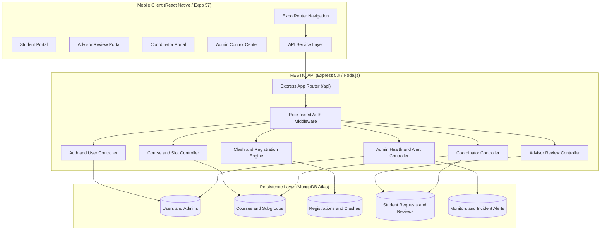

<div align="center">

# 🎓 University Timetable & Clash Detection System

<p align="center">
  <strong>An Intelligent, End-to-End Academic Scheduling & Conflict Resolution Ecosystem</strong>
</p>

[](https://reactnative.dev/)
[](https://expo.dev/)
[](https://www.typescriptlang.org/)
[](https://nodejs.org/)
[](https://expressjs.com/)
[](https://www.mongodb.com/)
[](LICENSE)

<br />

<p align="center">
  <a href="#-project-overview">Overview</a> •
  <a href="#-key-features--modules">Modules</a> •
  <a href="#-system-architecture">Architecture</a> •
  <a href="#-tech-stack">Tech Stack</a> •
  <a href="#-project-structure">Structure</a> •
  <a href="#-getting-started">Getting Started</a> •
  <a href="#-demo-credentials">Demo Accounts</a> •
  <a href="#-api-endpoints">API Docs</a>
</p>

---

</div>

## 📌 Project Overview

The **University Timetable & Clash Detection System** is an enterprise-grade mobile and cloud solution designed to eliminate course scheduling conflicts, streamline academic approvals, and provide administrators with real-time health monitoring of academic services.

By combining an intuitive **React Native (Expo SDK 57)** mobile client with an **Express.js & MongoDB** micro-backend, the platform provides role-tailored dashboards and workflows for **Students**, **Academic Advisors**, **Course Coordinators**, and **System Administrators**.

```
┌─────────────────┐       ┌─────────────────┐       ┌─────────────────┐       ┌─────────────────┐
│     STUDENT     │       │     ADVISOR     │       │   COORDINATOR   │       │      ADMIN      │
│  Registration   │ ────► │ Review & Draft  │ ◄───► │  Slot & Group   │ ◄───► │ Health, Users & │
│ Clash Detection │       │  Approval Flow  │       │  Optimization   │       │ Incident Alerts │
└─────────────────┘       └─────────────────┘       └─────────────────┘       └─────────────────┘
```

---

## 🌟 Key Features & Modules

### 👨‍🎓 1. Student Module (`Member 01`)
* **Live Course Catalog & Enrollment**: Browse accredited core and elective courses filtered by semester.
* **Instant Timetable Clash Engine**: Algorithmically detects overlapping lecture, tutorial, and lab time slots in real time.
* **Visual Interactive Schedule Grid**: Clean timetable visualization with period-by-period breakdowns.
* **Smart Alternative Subgroups**: Automatically suggests non-conflicting tutorial/lab subgroups when clashes arise.
* **Advisor Review Requests**: Submit formal clash override and subgroup change requests with reason logs.
* **Registration Confirmation**: Digital enrollment slip with semester credit calculations.

### 👨‍🏫 2. Academic Advisor Module (`Member 02`)
* **Advisor Request Dashboard**: Filter incoming clash issues into *Pending*, *Under Review*, and *Resolved* streams.
* **Review Draft Lifecycle (Full CRUD)**:
  * Create detailed draft evaluation notes.
  * Edit and update tentative decisions before submission.
  * Delete discarded drafts safely without affecting student records.
* **One-Click Formal Decisions**: Approve or reject timetable overrides with automated sync to student course registration records.
* **Advisor Profile & Timetable**: Track academic advisees and advisory schedule slots.

### 📋 3. Course Coordinator Module (`Member 03`)
* **Curriculum & Schedule Provisioning**: Configure course lecture sessions, lab slots, rooms, and assigned lecturers.
* **Subgroup Capacity Management**: Create and balance tutorial/lab subgroups with real-time seat tracking.
* **Clash Request Resolution**: Inspect aggregate clash patterns and reassign students to open alternative subgroups.
* **Enrollment Metrics**: Real-time enrollment numbers against venue capacity thresholds.

### 🛡️ 4. System Administrator Module (`Member 04`)
* **Executive Metrics Dashboard**: Real-time CPU load, memory utilization, cluster sync, and live request latency.
* **User Management (CRUD)**: Complete lifecycle administration for Students, Advisors, Coordinators, and Admins with instant role toggle and account deactivation.
* **Service Health Probes**: Active heartbeats and latency checks for `Clash Detection Core`, `Registration Gateway`, `Database Cluster`, and `Notification Queue`.
* **Incident Alert Center**: Filter, acknowledge, investigate, and resolve system anomalies with Time-to-Resolution (TTR) metrics.
* **Course Catalog Maintenance**: Create, edit, and audit system-wide course definitions.

---

## 🏗 System Architecture



---

## 💻 Tech Stack

| Category | Technology | Description |
| :--- | :--- | :--- |
| **Mobile Client** | **React Native 0.86** | Cross-platform mobile runtime |
| **Framework** | **Expo SDK 57** | Modern Expo Router, Expo Symbols & Safe Area |
| **Language** | **TypeScript 6.0** | End-to-end typed interfaces and safety |
| **Animation & UX** | **Reanimated 4.5 & Glass Effect** | Fluid gestures, glassmorphism, and micro-interactions |
| **API Backend** | **Node.js & Express 5.2** | High-performance asynchronous REST API |
| **Database** | **MongoDB Atlas & Mongoose 9.1** | Schema-driven document storage with query indexing |
| **Security** | **Bcrypt.js & Custom Role RBAC** | Password hashing and strict multi-role enforcement |
| **Architecture** | **Dynamic IP Auto-Discovery** | Zero-config API host resolution for Expo Go & Emulators |

---

## 📂 Project Structure

```text
University-Timetable-App/
├── backend/                       # REST API Backend
│   ├── src/
│   │   ├── config/                # Database connection & env setup
│   │   ├── controllers/           # Route handlers (Auth, Advisor, Admin, etc.)
│   │   ├── middleware/            # Role verification & error handlers
│   │   ├── models/                # Mongoose schemas (User, Course, Clash, Alert...)
│   │   ├── routes/                # Express endpoint definitions
│   │   ├── seed/                  # Comprehensive mock & initial seed data
│   │   │   ├── seedData.js        # Full system seed (Users, Courses, Monitors)
│   │   │   └── seedAdmin.js       # Admin user setup
│   │   ├── utils/                 # Timetable clash detection algorithm
│   │   └── server.js              # Entry server file
│   ├── test/                      # Backend integration and unit test suite
│   ├── .env                       # Environment variables
│   └── package.json
│
├── mobile/                        # React Native / Expo Application
│   ├── assets/                    # Icons, splash images, and brand media
│   ├── src/
│   │   ├── app/                   # Expo Router file-based navigation
│   │   │   ├── (tabs) / index.tsx # Welcome & Portal gateway
│   │   │   ├── Student/           # Student clash resolution & registration screens
│   │   │   ├── Advisor/           # Advisor review and draft management screens
│   │   │   ├── admin/             # Admin system monitors, health, users & alerts
│   │   │   ├── coordinator-dashboard.tsx
│   │   │   └── profile.tsx
│   │   ├── components/            # Reusable UI cards, tables, and modal components
│   │   ├── constants/             # Theme tokens, colors, and typography
│   │   ├── hooks/                 # Custom reactive React hooks
│   │   └── services/              # API fetchers (api.ts, advisorService.ts)
│   ├── app.json                   # Expo configuration manifest
│   ├── tsconfig.json              # TypeScript configuration
│   └── package.json
│
└── README.md                      # Project documentation
```

---

## 🚀 Getting Started

### 📋 Prerequisites
* **Node.js** (v18.0.0 or later recommended)
* **npm** or **bun**
* **MongoDB** (Local instance or free MongoDB Atlas URI)
* **Expo Go** mobile app on your physical device (iOS / Android) or an emulator.

---

### 1️⃣ Backend Setup

1. **Navigate to the backend directory**:
   ```bash
   cd backend
   ```

2. **Install dependencies**:
   ```bash
   npm install
   ```

3. **Configure Environment Variables**:
   Ensure `.env` exists in `backend/` with the following keys:
   ```env
   PORT=5001
   MONGO_URI=your_mongodb_connection_string
   JWT_SECRET=your_jwt_secret_key
   ```

4. **Seed Database with Sample Data**:
   Populates courses, clash schedules, admin users, health monitors, and alerts.
   ```bash
   npm run seed
   ```

5. **Start the API Server**:
   ```bash
   npm run dev
   ```
   * Server runs at: `http://localhost:5001`
   * Base API endpoint: `http://localhost:5001/api`

---

### 2️⃣ Mobile App Setup

1. **Navigate to the mobile directory**:
   ```bash
   cd ../mobile
   ```

2. **Install dependencies**:
   ```bash
   npm install
   ```

3. **Network Configuration (Physical Devices)**:
   The mobile client features **automatic host IP detection** via `expo-constants`. If running on a physical phone via **Expo Go**, verify that your PC and phone are on the **same Wi-Fi network**.
   *(Optional)* You can manually specify your LAN IP in [`mobile/src/services/api.ts`](mobile/src/services/api.ts):
   ```typescript
   const LOCAL_IP = '192.168.1.X'; // Your computer's local IP address
   ```

4. **Start the Expo Development Server**:
   ```bash
   npx expo start
   ```

5. **Launch the App**:
   * Scan the terminal QR code with **Expo Go** (Android) or the **Camera App** (iOS).
   * Press `a` for Android Emulator or `i` for iOS Simulator.
   * Press `w` to open in your web browser.

---

## 🔑 Demo Credentials

All test accounts are pre-seeded in the database for instant testing across all roles:

| Role | User ID / Identifier | Email / Username | Default Password | Access Level |
| :--- | :--- | :--- | :--- | :--- |
| **🛡️ Administrator** | `ADM001` | `admin@university.edu` | `User@123` *(or Admin@123)* | Full System Controls & Health |
| **👨‍🏫 Academic Advisor** | `ADV001` | `a.vance@university.edu` | `User@123` | Request Review & Draft CRUD |
| **📋 Course Coordinator** | `CRD001` | `j.hayes@university.edu` | `User@123` | Slots, Capacity & Subgroups |
| **🎓 Student** | `STU001` *(or IT21047138)* | `kasun.p@my.sliit.lk` | `User@123` | Course Selection & Clashes |
| **📡 Service Monitor** | `MON001` | `elena.r@infra.university.edu` | `User@123` | Diagnostic Log Inspection |

---

## 📡 API Reference Overview

The backend exposes a clean REST API divided into modular resource routers:

### 🔐 Authentication & Accounts
* `POST /api/auth/login` — Unified role-based login (Student, Advisor, Coordinator, Admin)
* `POST /api/auth/student-login` — Direct student authentication
* `POST /api/admin/auth/login` — Dedicated admin portal access

### 📚 Courses & Timetables
* `GET /api/courses?semester=:sem` — Fetch courses for a given semester
* `GET /api/dashboard/:studentId` — Retrieve student current timetable and clash reports
* `POST /api/registration/register` — Submit validated course registration
* `POST /api/coordinator/preview-timetable` — Preview timetable with proposed subgroup substitutions

### 📝 Student Requests & Advisor Reviews
* `POST /api/student-requests` — Submit clash override or subgroup transfer request
* `GET /api/student-requests/:studentId` — Retrieve student's submitted requests
* `GET /api/student-requests/all` — Aggregate requests feed for advisors and coordinators
* `POST /api/advisor-reviews` — Create draft or finalized advisor review
* `PUT /api/advisor-reviews/:reviewId` — Update draft comments & recommendations
* `DELETE /api/advisor-reviews/:reviewId` — Remove draft review

### 🛡️ Administration & Health Monitoring
* `GET /api/admin/dashboard/stats` — Real-time user, monitor, and incident summary
* `GET /api/admin/system-health` — Live server metrics, RAM, latency, and uptime
* `GET /api/admin/monitors` — List all infrastructure service health monitors
* `POST /api/admin/monitors/:id/check` — Execute instant health check ping on a service
* `GET /api/admin/alerts` — Fetch incident alert queue with severity filtering
* `PATCH /api/admin/alerts/:id/acknowledge` — Acknowledge active incident
* `PATCH /api/admin/alerts/:id/resolve` — Mark incident as resolved with resolution note
* `GET /api/admin/users` & `POST /api/admin/users` — Manage system accounts and roles

---

## 🧪 Testing & Quality Assurance

To execute the backend test suite:
```bash
cd backend
npm test
```

To run mobile TypeScript type checks and linting:
```bash
cd mobile
npx tsc --noEmit
npx expo lint
```

---

## 👥 Development Team & Contributions

This project was built through collaborative modular engineering:

* **Member 01**: Student Course Registration, Clash Detection Engine & Conflict Resolution Screens
* **Member 02**: Academic Advisor Review Workflow, Draft CRUD Architecture & Approval Engine
* **Member 03**: Course Coordinator Module, Slot Management & Subgroup Optimization
* **Member 04**: System Administration, Real-Time Health Probes, User Management & Incident Diagnostics

---

## 📄 License

This project is licensed under the **ISC / MIT License** — see the [LICENSE](LICENSE) file for details.

<div align="center">
  <sub>Built with ❤️ for seamless university scheduling and academic excellence.</sub>
</div>
